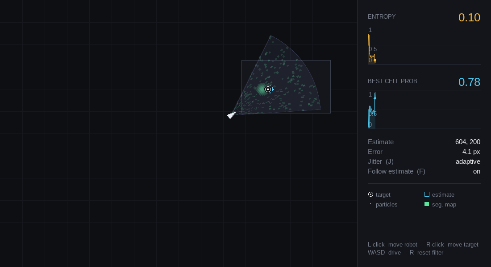

# Particle filter for target localization

A 2D simulator in which a robot finds a static target on a table using a
noisy, simulated segmentation network and a particle filter.



- The **segmentator** produces, every frame, a probability map over the
  robot's field of view: background noise, a blob where the target is (if it
  is detected), false-positive blobs, and occasional failure bursts.
- The **particle filter** keeps N guesses of the target position and weights
  them by how well each one explains the map. It reports an estimate and how
  uncertain it is (entropy, best-cell probability).
- By default the **robot follows the estimate**, so the robot moves closer to
  the target and the filter gets better measurements.

## How it works

| | |
|---|---|
| [docs/segmentator.md](docs/segmentator.md) | the simulated segmentator: what the map contains and how it is generated |
| [docs/particle-filter.md](docs/particle-filter.md) | the filter: algorithm, likelihood model, jitter, entropy and estimate |

The simulator and the filter each have their own model of the segmentator. The
filter's model deliberately leaves out some of the simulator's behaviour
(failure bursts, exact blob shape), so it is tested against data it does not
model perfectly.

## Running

Requires Python 3.10+.

```sh
python -m venv .venv
source .venv/bin/activate
pip install -r requirements.txt
python main.py
```

With Nix and direnv, `direnv allow` sets up the environment from
[`flake.nix`](flake.nix) and creates the virtualenv automatically.

## Controls

| Input | Action |
|---|---|
| Left click | send the robot to that point (turns off following) |
| Right click | move the target there (new table, filter reset) |
| `W` `A` `S` `D` / arrow keys | drive the robot manually |
| `F` | toggle following the estimate |
| `J` | switch jitter between adaptive and fixed |
| `R` | reset the filter to the uniform prior |
| `Esc` | quit |

## Project layout

```
main.py             simulator loop, input, drawing, side panel
robot.py            robot pose, field of view, motion (keys, go-to, follow)
segmentator.py      simulated segmentator (the only code that knows the true target)
particle_filter.py  particle filter, likelihood model, entropy and estimate
plot.py             scrolling line plots for the side panel
theme.py            colours and fonts
docs/               model and algorithm write-ups
```
